
<a href="https://saikanagat.com/"><picture><source media="(prefers-color-scheme: dark)" srcset="assets/hero-dark.svg"></picture></a><a href="https://saikanagat.com/about"><picture><source media="(prefers-color-scheme: dark)" srcset="assets/about-dark.svg"></picture></a><a href="https://saikanagat.com/blog/building-nishta"><picture><source media="(prefers-color-scheme: dark)" srcset="assets/nishta-dark.svg"></picture></a><picture><source media="(prefers-color-scheme: dark)" srcset="assets/ch1-dark.svg"></picture><a href="https://github.com/Sai-Kanagat/thallo"><picture><source media="(prefers-color-scheme: dark)" srcset="assets/thallo-dark.svg"></picture></a><a href="https://github.com/Sai-Kanagat/cortex-studio"><picture><source media="(prefers-color-scheme: dark)" srcset="assets/cortex-dark.svg"></picture></a><picture><source media="(prefers-color-scheme: dark)" srcset="assets/ch2-dark.svg"></picture><a href="https://github.com/content-vigilante/Content-Vigilante"><picture><source media="(prefers-color-scheme: dark)" srcset="assets/vigilante-dark.svg"></picture></a><a href="https://saikanagat.com/ad-autopsy"><picture><source media="(prefers-color-scheme: dark)" srcset="assets/autopsy-dark.svg"></picture></a><a href="https://github.com/Sai-Kanagat/ctr-lab"><picture><source media="(prefers-color-scheme: dark)" srcset="assets/ctr-dark.svg"></picture></a><picture><source media="(prefers-color-scheme: dark)" srcset="assets/ch3-dark.svg"></picture><a href="https://saikanagat.com/work#arabella"><picture><source media="(prefers-color-scheme: dark)" srcset="assets/arabella-dark.svg"></picture></a><a href="https://saikanagat.com/work#casamota"><picture><source media="(prefers-color-scheme: dark)" srcset="assets/verde-dark.svg"></picture></a><a href="https://saikanagat.com/aperol-golden-hour"><picture><source media="(prefers-color-scheme: dark)" srcset="assets/aperol-dark.svg"></picture></a><a href="https://github.com/Sai-Kanagat/backpack-bottle"><picture><source media="(prefers-color-scheme: dark)" srcset="assets/backpack-dark.svg"></picture></a><picture><source media="(prefers-color-scheme: dark)" srcset="assets/ch4-dark.svg"></picture><a href="https://saikanagat.com/papers/monocular-biomechanics"><picture><source media="(prefers-color-scheme: dark)" srcset="assets/biomechanics-dark.svg"></picture></a><a href="https://saikanagat.com/demos/agora"><picture><source media="(prefers-color-scheme: dark)" srcset="assets/agora-dark.svg"></picture></a><a href="https://github.com/Sai-Kanagat/adlib"><picture><source media="(prefers-color-scheme: dark)" srcset="assets/adlib-dark.svg"></picture></a><a href="https://saikanagat.com/melt"><picture><source media="(prefers-color-scheme: dark)" srcset="assets/melt-dark.svg"></picture></a><a href="https://saikanagat.com/shadow-theatre"><picture><source media="(prefers-color-scheme: dark)" srcset="assets/shadow-dark.svg"></picture></a><a href="https://saikanagat.com/work"><picture><source media="(prefers-color-scheme: dark)" srcset="assets/out-dark.svg"></picture></a><a href="https://saikanagat.com/contact"><picture><source media="(prefers-color-scheme: dark)" srcset="assets/site-dark.svg"></picture></a><a href="https://www.linkedin.com/in/sai-kanagat"><picture><source media="(prefers-color-scheme: dark)" srcset="assets/linkedin-dark.svg"></picture></a>

The same thing in words

- [It started with a chair](https://saikanagat.com/about): I trained as an industrial designer in Coimbatore. Then I saw that the same parts could build something else. I still work by jugaad: make it work with what is in the room. Off hours it is physics, AI and history.
- [Nishta](https://saikanagat.com/blog/building-nishta): my consultancy. A DTC client held 3.2 times ROAS over six months of Meta and Google Ads. A multi-branch retail client grew organic traffic 40% in six months. Now I market three B2B brands at e-FEM and MaCh3D in Parma, while finishing a Master at Bologna Business School.

**Campaigns end. Machines keep running.**

- [Thallo](https://github.com/Sai-Kanagat/thallo): a marketing system for small businesses, in development. Nothing publishes until a person approves that exact version.
- [Cortex Studio](https://github.com/Sai-Kanagat/cortex-studio): a LangGraph agent graph that turns a brief into a campaign, with a human gate, tests and a browser demo.

**A good machine also knows how to say no.**

- [Content Vigilante](https://github.com/content-vigilante/Content-Vigilante): a local first brand voice auditor and marketing workspace. Bring your own model.
- [Ad Autopsy](https://saikanagat.com/ad-autopsy): attention heatmap, gaze path and feed tests for an ad, all in the browser.
- [CTR Lab](https://github.com/Sai-Kanagat/ctr-lab): three click prediction models on public 2014 Avazu data. DeepFM's top 10% of impressions holds 26.7% of test clicks. One run, caveats in the repo.

**I never put the chair down.**

- [ARABELLA](https://saikanagat.com/work#arabella): a bamboo furniture line for the Indian middle market, designed at Auroville Bamboo Centre. Product, brand and launch content.
- [Verde](https://saikanagat.com/work#casamota): sourcing, layout and installation for the Verde textile line by Carlos Mota, featured in Architectural Digest (2022).
- [Aperol, The Golden Hour](https://saikanagat.com/aperol-golden-hour): a speculative launch: positioning, art direction, four-city activation and media plan.
- [Backpack & Bottle](https://github.com/Sai-Kanagat/backpack-bottle): a Bologna Business School group campaign in Next.js, with GTM, GA4, Meta Pixel and Google Ads under Consent Mode v2.

**And some things I build just to find out.**

- [Monocular Biomechanics](https://saikanagat.com/papers/monocular-biomechanics): an independent research paper on reading the forces inside a body from one camera.
- [Agora](https://saikanagat.com/demos/agora): type a scenario and watch a synthetic crowd react.
- [adlib](https://github.com/Sai-Kanagat/adlib): Chrome side panel and dashboard for Meta ad research. Runs on mock data today.
- [Melt Sprint](https://saikanagat.com/melt): a first person movement game where every texture is a live shader.
- [Shadow Theatre](https://saikanagat.com/shadow-theatre): hand shadow puppets, many drawn from the hastas of Bharatanatyam. The feed stays on your machine.
- [Work](https://saikanagat.com/work): everything else, including product, graphics and installation work.

The graphics are hand-generated SVG. No widgets, no trackers, no scripts. The CTR Lab curve is plotted from the real results file.

