<a href="https://saikanagat.com/"><picture><source media="(prefers-color-scheme: dark)" srcset="assets/hero-dark.svg"></picture></a><a href="https://github.com/Sai-Kanagat/thallo"><picture><source media="(prefers-color-scheme: dark)" srcset="assets/thallo-dark.svg"></picture></a><a href="https://saikanagat.com/shadow-theatre"><picture><source media="(prefers-color-scheme: dark)" srcset="assets/shadow-dark.svg"></picture></a><a href="https://github.com/Sai-Kanagat/cortex-studio"><picture><source media="(prefers-color-scheme: dark)" srcset="assets/cortex-dark.svg"></picture></a><a href="https://saikanagat.com/ad-autopsy"><picture><source media="(prefers-color-scheme: dark)" srcset="assets/autopsy-dark.svg"></picture></a><a href="https://saikanagat.com/melt"><picture><source media="(prefers-color-scheme: dark)" srcset="assets/melt-dark.svg"></picture></a><a href="https://github.com/Sai-Kanagat/ctr-lab"><picture><source media="(prefers-color-scheme: dark)" srcset="assets/ctr-dark.svg"></picture></a><a href="https://saikanagat.com/papers/monocular-biomechanics"><picture><source media="(prefers-color-scheme: dark)" srcset="assets/biomechanics-dark.svg"></picture></a><a href="https://github.com/content-vigilante/Content-Vigilante"><picture><source media="(prefers-color-scheme: dark)" srcset="assets/vigilante-dark.svg"></picture></a><a href="https://saikanagat.com/demos/agora"><picture><source media="(prefers-color-scheme: dark)" srcset="assets/agora-dark.svg"></picture></a><a href="https://saikanagat.com/work"><picture><source media="(prefers-color-scheme: dark)" srcset="assets/out-dark.svg"></picture></a><a href="https://saikanagat.com/"><picture><source media="(prefers-color-scheme: dark)" srcset="assets/site-dark.svg"></picture></a><a href="https://www.linkedin.com/in/sai-kanagat"><picture><source media="(prefers-color-scheme: dark)" srcset="assets/linkedin-dark.svg"></picture></a>

The same thing in words

Every floor of the machine is a link.

- [Thallo](https://github.com/Sai-Kanagat/thallo): a marketing system for small businesses, in development. Nothing publishes until a person approves that exact version.
- [Shadow Theatre](https://saikanagat.com/shadow-theatre): hand shadow puppets through your camera, many drawn from the hastas of Bharatanatyam. The feed stays on your machine.
- [Cortex Studio](https://github.com/Sai-Kanagat/cortex-studio): a LangGraph agent graph for campaigns, with a human gate before the package is built.
- [Ad Autopsy](https://saikanagat.com/ad-autopsy): attention heatmap, gaze path and feed tests for an ad, all in the browser.
- [Melt Sprint](https://saikanagat.com/melt): a first person movement game where every texture is a live shader.
- [CTR Lab](https://github.com/Sai-Kanagat/ctr-lab): three click prediction models on public 2014 Avazu data. DeepFM's top 10% of impressions holds 26.7% of test clicks. One run, caveats in the repo.
- [Monocular Biomechanics](https://saikanagat.com/papers/monocular-biomechanics): an independent research paper.
- [Content Vigilante](https://github.com/content-vigilante/Content-Vigilante): a local first brand voice auditor. Bring your own model.
- [Agora](https://saikanagat.com/demos/agora): type a scenario and watch a synthetic crowd take sides.

The graphics are hand-generated SVG. No widgets, no trackers, no scripts. The CTR Lab curve is plotted from the real results file.

